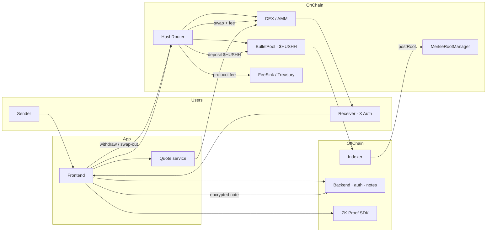
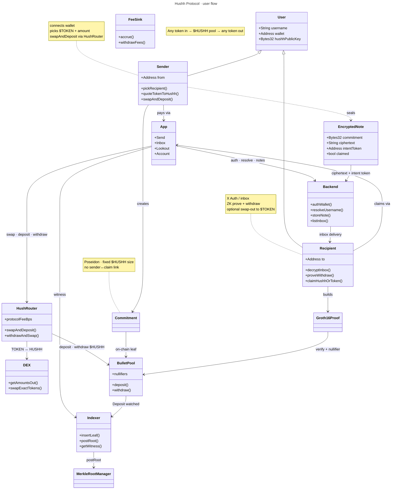

# Hushh Protocol

ZK-private payment rail on **Arc Testnet** (EVM). Any ERC-20 enters as **`$HUSHH`**, mixes in a single shielded pool, then exits as the receiver’s token — with no on-chain link between deposit and withdraw.

Tagline: send silently.

### Live

| Service | URL |
|---------|-----|
| **App** | [https://hush-protocol-zeta.vercel.app](https://hush-protocol-zeta.vercel.app) |
| **Backend** | [https://hush-protocol-backend.onrender.com](https://hush-protocol-backend.onrender.com) |
| **Indexer** | [https://hush-protocol-indexer.onrender.com](https://hush-protocol-indexer.onrender.com) |
| **Explorer** | [https://testnet.arcscan.app](https://testnet.arcscan.app) |
| **RPC** | `https://rpc.testnet.arc.network` (chain id `5042002`) |

---

## Core model

```
Sender ($BUM) → swap → $HUSHH → [ BulletPool · ZK ] → $HUSHH → swap → Receiver ($BUM)
```

| Stage | What happens |
|-------|----------------|
| **Swap in** | User token → `$HUSHH` via DEX / AMM (direct or via USDC / WETH) |
| **Private pool** | Fixed-denomination `$HUSHH` notes; Poseidon commitments; Groth16 withdraw |
| **Swap out** | `$HUSHH` → intent token for the receiver |
| **Revenue** | Protocol fee on router swaps (+ optional pool fee) → treasury |

Privacy set is **one asset** (`$HUSHH`). Multi-token UX lives at the router, not inside the pool.

---

## Architecture overview



### Layer stack

```
HushRouter + DEX          ← multi-token in/out, fees, quotes
      ↓
BulletPool ($HUSHH only)  ← ZK privacy core
      ↓
ZK Circuit (Circom / BN254 Groth16)
      ↓
Proof SDK (TypeScript)
      ↓
Indexer (Merkle tree + postRoot + witness API)
      ↓
Backend (auth, usernames, encrypted notes)
      ↓
Frontend (send / inbox / claim)
```

| Component | Responsibility |
|-----------|----------------|
| **`$HUSHH`** | Protocol rail ERC-20; only asset inside the shielded pool |
| **HushRouter** | `swapAndDeposit` / `withdrawAndSwap`; takes protocol bps → FeeSink |
| **DEX / AMM** | Liquidity for `$TOKEN ↔ $HUSHH` (direct or via USDC / WETH) |
| **BulletPool** | Hold `$HUSHH`, verify proofs, nullifiers, deposit events |
| **MerkleRootManager** | Rolling window of valid Merkle roots |
| **Indexer** | Watch deposits, Poseidon tree, `postRoot`, serve witnesses |
| **SDK** | Secrets, commitments, nullifiers, Groth16 proving |
| **Backend** | Wallet auth, `@username` → keys, encrypted inbox |
| **Quote service** | Path discovery, amounts-out, fee + slippage, note snap |
| **Frontend** | Multi-token send, inbox, claim-as-token or keep `$HUSHH` |

---

## User flow



Nothing on-chain links the sender’s deposit to the recipient’s withdraw. Swaps around the pool are public; the pool breaks the link.

---

## Problem

Public blockchains leave a visible trail. Every transfer creates a `sender → recipient` edge anyone can follow. That makes salary, donations, remittances, and contractor payments uncomfortable when the relationship itself should stay private.

## What Hushh Protocol is

Hushh is a **`$HUSHH`-centric shielded note pool** with a multi-token edge:

1. Sender picks any supported ERC-20 and amount. The app quotes a path to `$HUSHH`.
2. **HushRouter** swaps in, takes a protocol fee, and deposits fixed-size `$HUSHH` note(s) under a Poseidon commitment.
3. Indexer inserts the commitment into a Merkle tree and posts the root on-chain.
4. Recipient authenticates (e.g. X), decrypts the inbox note, withdraws with a Groth16 proof, then optionally swaps `$HUSHH` → their intent token.
5. Nothing on-chain connects the deposit transaction to the withdraw transaction.

### Privacy model (stated plainly)

- **Unlinkability** of deposit ↔ withdraw (membership + nullifier).
- **Unified anonymity set** — all notes are `$HUSHH` of fixed denominations.
- **Fixed denominations** for amount-matching resistance. Amounts are standardized, not encrypted.
- **Not** a full shielded pool with hidden balances (future work).
- Swap-in / swap-out txs are visible; timing analysis is mitigated by volume + fixed sizes.
- Merkle roots are posted by a relayer. Decentralizing the indexer is future work.

### Honest privacy limits

- Fixed denominations, not encrypted balances.
- Anonymity scales with pool size.
- Root posting is permissioned (indexer / relayer).
- Trusted setup is single-contributor until an MPC ceremony.
- Off-chain delivery (claim links, X) can leak metadata; on-chain unlinkability still holds.
- Intent token on the note is **UX metadata**, not part of the ZK statement.

---

## Token & quote paths

User-facing tokens are arbitrary ERC-20s. The pool only ever sees `$HUSHH`.

| Preference | Path | Pools needed |
|------------|------|----------------|
| **Best** | Direct | `TOKEN / HUSHH` |
| **Payments hub** | Via USDC | `TOKEN / USDC` + `HUSHH / USDC` |
| **Fallback** | Via WETH | `TOKEN / WETH` + `HUSHH / WETH` |

**Send quote**

```
amountIn ($BUM)
  → best path getAmountsOut
  → apply protocolFeeBps
  → floor to fixed $HUSHH note size(s)
  → return path, hushhOut, fee, minOut, slippage
```

**Claim quote** — reverse: `$HUSHH` → intent token (`$BUM`).

Bulk sends compose several fixed `$HUSHH` notes.

---

## End-to-end flows

### Send

```
1. UI: recipient + tokenIn + amount
2. Quote: path · fee · snap to $HUSHH denominations
3. SDK: secret → commitment; encrypt note (incl. intentToken)
4. HushRouter.swapAndDeposit(...)
     ├─ DEX: tokenIn → $HUSHH
     ├─ FeeSink: protocol bps
     └─ BulletPool.deposit($HUSHH, noteAmount, commitment)
5. Indexer: insert leaf → postRoot
6. Backend: POST /notes (ciphertext + intent metadata)
```

### Claim

```
1. Recipient: X Auth / wallet session
2. Backend: GET /notes → decrypt locally
3. Indexer: GET /witness/:commitment
4. SDK: generateProof(note, merklePath)
5. HushRouter.withdrawAndSwap(...)  (or withdraw then optional swap)
     ├─ BulletPool.withdraw → $HUSHH
     └─ DEX: $HUSHH → intentToken  (or keep $HUSHH)
6. Backend: PATCH /notes/:id/claim
```

---

## Revenue

| Leg | Mechanism | Recipient |
|-----|-----------|-----------|
| Swap in | DEX LP fee | Liquidity providers |
| Swap in | HushRouter `protocolFeeBps` | FeeSink / treasury |
| Pool (optional) | deposit / withdraw bps | FeeSink / treasury |
| Swap out | DEX LP + protocol bps | LPs + treasury |

Platform take is primarily on the **router**. Owning LP positions on `$HUSHH` pairs is optional extra yield.

---

## Network

| Setting | Value |
|---------|--------|
| Network | Arc Testnet |
| Chain ID | `5042002` |
| Rail token | `$HUSHH` (pool asset) |
| Edge tokens | Any supported ERC-20 via router + DEX |
| RPC | `https://rpc.testnet.arc.network` |
| Explorer | [testnet.arcscan.app](https://testnet.arcscan.app) |

---

## On-chain contracts

```
HushRouter.sol           swapAndDeposit / withdrawAndSwap, protocol fee
FeeSink.sol              accrue + withdraw protocol revenue
BulletPool.sol           deposit / withdraw $HUSHH, nullifiers
MerkleRootManager.sol    rolling window of 64 valid roots
WithdrawVerifier.sol     Groth16 verifier
Hushh.sol                protocol ERC-20 rail token
MockUSDC.sol             test ERC-20 (and other mocks as needed)
```

### ZK circuit

Only **withdraw** needs a circuit. Deposit is commitment + ERC-20 transfer + event.

```
nullifier  = Poseidon([secret])
commitment = Poseidon([secret, recipientDigest, amount, tokenHash])
```

Public inputs (locked): `[root, nullifier, recipientDigest, amount, tokenHash]`

`tokenHash = uint256(uint160(tokenAddress))` — for the pool rail, this is **`$HUSHH`**.

---

## Note payload (app layer)

Encrypted note carries ZK fields plus claim UX:

| Field | On-chain / ZK | Purpose |
|-------|---------------|---------|
| `secret` | private | Derive nullifier + open note |
| `recipientDigest` | public in proof | Bind recipient stealth digest |
| `hushhAmount` | public in proof | Fixed denomination |
| `tokenHash` | public in proof | Always `$HUSHH` in pool |
| `commitment` | deposit event | Merkle leaf |
| `intentToken` | off-chain only | What receiver wants out (e.g. `$BUM`) |
| `intentAmountHint` | off-chain only | Quote at send time (informational) |

---

## Repo layout

Active stack lives in `arc-contracts/`:

```
Hush-Protocol/
├── frontend/          Next.js app (types in src/shared/)
└── arc-contracts/
    ├── contracts/     Solidity (Hardhat) — pool, router, rail token
    ├── zk/            Circom withdraw circuit + snarkjs
    ├── sdk/           Proof SDK (@bullet/sdk)
    ├── indexer/       Deposit watcher + witness API
    ├── backend/       Wallet auth, usernames, encrypted notes
    ├── scripts/       Deploy, token ops, status
    ├── test/          Hardhat tests
    └── deployments/   Per-network addresses
```

Legacy Stellar/Soroban packages are not the current target. Development continues on Arc + Solidity.

---

## Implementation status

| Piece | Status |
|-------|--------|
| BulletPool + MerkleRootManager + Groth16 withdraw | **Live** (multi-token registry today) |
| Indexer + Backend + Frontend send/claim | **Live** |
| `$HUSHH` rail + pool restricted to `$HUSHH` | **Architecture target** |
| HushRouter + FeeSink + quote service | **Architecture target** |
| DEX liquidity (`HUSHH/USDC` hub) | **Architecture target** |

Current testnet still deposits registered ERC-20s (USDC, EURC, …) directly into BulletPool. The architecture above is the product direction: **router edge + single-asset `$HUSHH` pool**.

---

## Quick start

Requirements: Node 22+, pnpm 9+, Circom (for circuit builds), MongoDB (indexer / backend).

```bash
cd arc-contracts
pnpm install --ignore-workspace
cp .env.example .env          # set PRIVATE_KEY
pnpm test
```

### Build ZK + SDK

```bash
# Circom: cargo install --git https://github.com/iden3/circom.git circom --locked
pnpm zk:install && pnpm zk:build
pnpm sdk:install && pnpm sdk:build && pnpm sdk:test
```

### Deploy to Arc Testnet

```bash
pnpm deploy          # Arc Testnet (needs PRIVATE_KEY in .env)
pnpm status
```

Writes `deployments/arcTestnet.json` (pool, root manager, verifier, MockUSDC).

| Contract | Address |
|----------|---------|
| BulletPool | `0x9E65584C6ACE76cEFde4FD5f50E6bB9763999dCe` |
| MerkleRootManager | `0x6D6530A1fC908792DA2aa533a5F299283E6F062a` |
| BulletVerifier | `0x0A95c430Bf6AA3140A4Bf04C8D5982472331008d` |
| MockUSDC | `0x7d7aF5715e5671e0E3126b2428Dc2629bD9061e3` |

### Indexer

```bash
pnpm indexer:install
cp indexer/.env.example indexer/.env
# BULLET_POOL_ADDRESS, MERKLE_ROOT_MANAGER_ADDRESS, RELAYER_PRIVATE_KEY
# DATABASE_URL=mongodb+srv://…/hushh_indexer
# RPC_URL=https://rpc.testnet.arc.network  CHAIN_ID=5042002

pnpm indexer:migrate
pnpm indexer:dev                 # API :4010
```

Witness API: `GET /witness/:commitment` (no secrets returned).

### Backend

```bash
pnpm backend:install
# MONGODB_URI=mongodb+srv://…/hushh
pnpm backend:db
pnpm backend:dev                 # API :4020
```

Auth / resolve / inbox only. No proving. No Merkle. No chain calls.

### Frontend env

```bash
cp frontend/.env.example frontend/.env
# addresses already filled from deployments/arcTestnet.json
# Local:
# NEXT_PUBLIC_FRONTEND_URL=http://localhost:3000
# NEXT_PUBLIC_BACKEND_URL=http://127.0.0.1:4020
# NEXT_PUBLIC_INDEXER_URL=http://127.0.0.1:4010
# Hosted:
# NEXT_PUBLIC_FRONTEND_URL=https://hush-protocol-zeta.vercel.app
# NEXT_PUBLIC_BACKEND_URL=https://hush-protocol-backend.onrender.com
# NEXT_PUBLIC_INDEXER_URL=https://hush-protocol-indexer.onrender.com
```

---

## Protocol flow (current SDK path)

Until HushRouter lands, the live path deposits the chosen pool token directly:

```
Deposit
  SDK: secret → commitment + encrypt note to recipient hushhPublicKey
  BulletPool.deposit(token, amount, commitment)
  Indexer: insert leaf → postRoot
  Backend: POST /notes (ciphertext only)

Withdraw
  Backend: GET /notes → decrypt locally
  Indexer: GET /witness/:commitment
  SDK: generateProof(note, merklePath)
  BulletPool.withdraw(proof, root, nullifier, recipientDigest, recipient, token, amount)
  Backend: PATCH /notes/:id/claim
```

Target path wraps deposit/withdraw with `HushRouter` + DEX as in **End-to-end flows** above.

### SDK usage

```ts
import {
  createNote,
  MerkleTree,
  generateProof,
  encodeProof,
  tokenHash,
} from "@bullet/sdk";

const note = await createNote({
  recipientDigest,
  amount: 10_000_000n, // fixed $HUSHH (or current pool token) units
  token: hushhAddress,
});
// deposit(note.commitmentBytes32) …
// later: generateProof(note, witness, { wasmPath, zkeyPath })
```

Frontend should call the SDK. Never reimplement Poseidon / proving in the app.

---

## Build phases (architecture rollout)

| Phase | Deliverable |
|-------|-------------|
| **A** | Deploy `$HUSHH` + seed `$HUSHH/USDC` (or WETH) liquidity |
| **B** | Restrict BulletPool to `$HUSHH`; fixed denoms in `$HUSHH` |
| **C** | `HushRouter.swapAndDeposit` + FeeSink |
| **D** | Quote API + Send UI (any token → `$HUSHH`) |
| **E** | `withdrawAndSwap` + Claim “get original token” |
| **F** | Treasury dashboards / fee withdraw |

ZK circuit, indexer, and auth do **not** need a rewrite for this architecture.

---

## Scripts (`arc-contracts`)

| Command | Purpose |
|---------|---------|
| `pnpm test` | Hardhat contract tests |
| `pnpm deploy` | Full stack deploy to Arc Testnet |
| `pnpm deploy:token` | Deploy / register MockUSDC on Arc |
| `pnpm add:token` / `remove:token` | Token registry |
| `pnpm mint:token` | Mint MockUSDC |
| `pnpm post:root` | Manual root post |
| `pnpm status` | Print deployment file + on-chain status |
| `pnpm zk:build` | Circuit → zkey → Verifier.sol |
| `pnpm indexer:dev` | Run indexer API |
